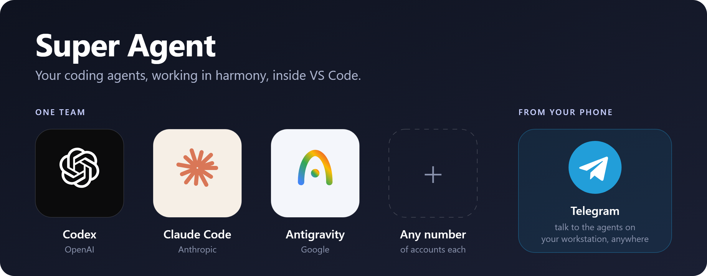
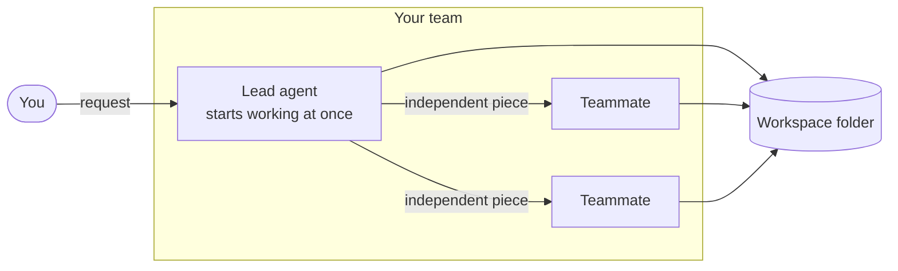
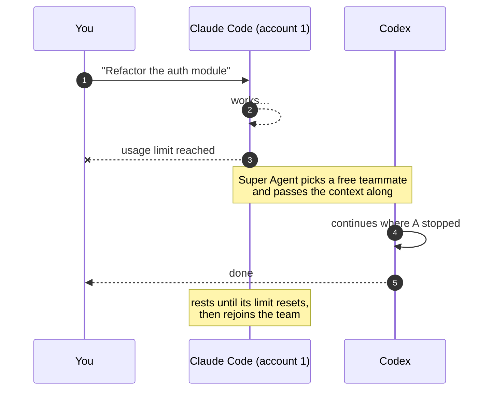
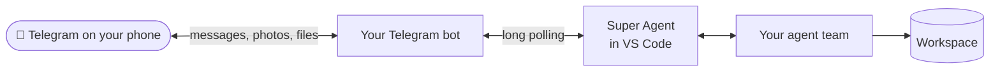

<p align="center">
  
</p>

<p align="center">
  <b>One agent leads, the team helps.</b><br>
  <b>The Avengers of coding agents: Claude Code, Codex and Antigravity as one team.</b><br>
  Super Agent turns every coding-agent login you have into a single team that works in your VS Code workspace,<br>
  and keeps working when one of them runs out of usage.
</p>

<p align="center">
  <a href="https://marketplace.visualstudio.com/items?itemName=touhidul-islam.super-agent-touhid">
    
  </a>
</p>

<p align="center">
  <a href="https://touhid314.github.io/super-agent/">Visit the Super Agent website</a>
</p>

---

## Getting started

1. Install [**Super Agent** from the VS Code Marketplace](https://marketplace.visualstudio.com/items?itemName=touhidul-islam.super-agent-touhid) on Windows 10/11 or Linux x64. For Remote SSH, install it on the Linux host.
2. On first start it offers to install the agent CLIs you don't have yet (**Codex**, **Claude Code**, **Antigravity**) with each maker's official installer. No admin rights or Node.js needed.
3. Open the Super Agent panel in the Activity Bar, click **+** to add an account and sign in. Add as many accounts as you have.
4. Open a folder and ask the team for anything.

Super Agent is an **always-on agent**: it keeps working on your workstation, and you reach the team from Telegram wherever you are. Messages, progress and permission requests all go through the chat. Microphone dictation is available in local Windows workspaces.

## Why Super Agent

Coding agents are great until you hit a usage limit in the middle of a task, or until you have three subscriptions and can only drive one at a time. Super Agent puts **Codex**, **Claude Code** and **Antigravity**, with as many accounts of each as you like, behind one panel, and lets them work together:

|   |   |
|---|---|
| 🤝 **Agents in harmony** | One agent leads a request and works on it right away. It hands independent pieces to free teammates, who work on them in parallel in the same folder. |
| 🔁 **Never stuck on a limit** | When the working agent runs out of usage, a free teammate picks up exactly where it stopped, with the full context. |
| 📱 **Your workstation, from your phone** | Pair a Telegram bot and talk to the team, browse your workspace and follow live progress from anywhere. |
| 📊 **Usage at a glance** | Usage left for every account, 5-hour and weekly, and when each limit resets. |

## Leader-based, not orchestrator-based

Most multi-agent systems, like [OpenClaw](https://docs.openclaw.ai/tools/subagents), put an orchestrator on top: it plans, briefs sub-agents, waits, then merges. Every plan and hand-off adds friction and slows the work, often for little gain. Super Agent has **no separate orchestrator agent**: a working coding agent leads, starts on the task itself, keeps its own session, and hands only independent pieces to free teammates in the same folder. The lead still coordinates the work; the distinction is that there is no separate manager model.

| | Separate-manager setups often... | Super Agent |
|---|---|---|
| **Who's in charge** | Put a dedicated manager above the workers. | A working coding agent leads the request. |
| **First action** | Start with a manager planning or routing the request. | The lead starts on the task itself and can delegate independent pieces. |
| **Small tasks** | Route through the manager, which may handle them directly or delegate. | The lead can finish them itself; a teammate is optional. |
| **Context** | Keep manager and worker sessions separate; shared history varies by setup. | The lead keeps its own session across turns; teammates receive scoped tasks. |
| **Handoffs** | Use manager-to-worker assignments and reports. | The working lead writes a task and file ownership for a free teammate, then reviews its report. |
| **Separate manager model** | Use a dedicated manager model for coordination. | No separate manager model; the coding agent also leads. |
| **A message while busy** | Route it according to the manager's queue or concurrency policy. | A free agent leads the new request in its own thread; if none is free, it waits. |

For example: **"Fix the login bug and add tests."** The lead fixes the bug while a free teammate writes tests against the agreed behavior, working in separate files in the same folder.

### Any setup

- **One account:** use the panel, usage meters, Telegram, thread history and Explorer marks with a single coding agent.
- **Several accounts of the same agent:** same-CLI hand-over can continue the same session on another account, subject to provider rules and usage limits.
- **A mixed team:** supported coding agents can lead and help with independent pieces in the same folder.

## Supported agents

| Agent | By | Accounts |
|---|---|---|
| **Codex** | OpenAI | as many as you like |
| **Claude Code** | Anthropic | as many as you like |
| **Antigravity** | Google | as many as you like |

Mix and match freely: two Claude Code accounts, a Codex account and an Antigravity account make a team of four. Each member shows its brand logo and the model it runs, and you can pick the model per agent.

> **Antigravity note:** Google's consumer terms do not support wrapping `agy` with a personal OAuth login in third-party apps; `GEMINI_API_KEY` (supported when adding Antigravity) or Vertex AI is Google's officially supported path.

## How the team works



- **No planning step.** The lead starts on the task immediately and keeps its own session from turn to turn.
- **Helping hands.** While it works, the lead can spin off independent pieces. Free teammates pick them up and work in parallel; their threads appear under the conversation.
- **Busy? Someone else takes it.** A message sent while the lead is busy goes to a free agent, which leads that request as its own thread.
- **Choose who leads.** Mark a preferred lead (♛), take members off the team, or pin a specific agent to a thread.

## Seamless hand-over when usage runs out



- **Same CLI** (for example, Claude Code account 1 to account 2): the new agent continues the **exact same session**.
- **Different CLI** (for example, Claude Code to Codex): the new agent receives the previous agent's **own session**: every message, tool call and tool output, converted from the other CLI's transcript. As much as fits goes straight into its prompt (newest first, with long outputs trimmed in the middle). The complete transcript is saved to a file it can read for anything older. Hidden reasoning isn't stored readably by the CLIs, so that part can't be carried over. Antigravity, which takes its prompt as a command-line argument, gets a shorter inline part plus the file.
- An agent that ran out rests until its limit resets, using the reset time the provider reports, and then rejoins automatically.
- Free agents with the most usage left are chosen first.

## Telegram: the team in your pocket



- **Talk to the same team** the panel uses. Replies come back formatted, with code blocks intact.
- **Live progress.** One status message shows who is working, for how long and what they are doing right now, and turns into "Done in …" at the end.
- **Send photos and files**; they are attached to your request.
- **Talk instead of type.** Send a voice message (or an OGG, MP3, WAV or FLAC audio file). Whisper transcribes it on your own machine, so the audio never goes to a speech service. The chat shows you the words (🎙️ *…*), and the team works on them like a typed message. The first voice message triggers a one-time download of whisper.cpp and the speech model (about 150 MB; set with the voice model setting).
- **Receive images and videos from your agents.** Ask for a screenshot, preview, or finished video: local media linked in the agent's final reply is uploaded to your paired Telegram chat automatically (up to five files per reply). MP4 videos play in the chat; unsupported preview formats arrive as downloadable originals. Files must be at most 50 MB. Failed uploads are reported in the chat.
- **Browse the workspace** from the chat: tap through folders and files, see recently changed files and search by name.
- **Preview saved videos:** open an MP4 in `/files` and tap **Video**, or download the original file.
- **Manage the team** from the chat: see who is on the team and who leads, and change it with a tap.
- **Threads:** start a new thread, switch between recent ones, or stop the current one.
- **Private by design.** Only the chat you pair (with a one-time code or a QR code) can talk to your agents. The extension polls Telegram itself, so nothing on your machine has to be reachable from the internet. The bot token is kept in VS Code's secret storage.

| Bot command | What it does |
|---|---|
| `/team` | who's on the team and who leads (tap to change) |
| `/files` | explore the workspace folder |
| `/recent` | recently changed files |
| `/find NAME` | search the workspace |
| `/new` | start a new thread |
| `/threads` | recent threads (switch with `/use N`) |
| `/stop` | stop the current thread |

## Usage, always visible

```
Claude Code · work        Codex · personal
5h   ████████░░  81% left  5h   ██████████  100% left
     resets in 1h 24m      week ███████░░░   70% left
                                resets in 2d
```

- Usage left for every account, for both the 5-hour and the weekly window.
- When each limit resets.
- The same numbers in the status bar tooltip.

## Built for VS Code

- **A panel in the Activity Bar** with the team as chips at the top, the conversation in the middle and a prompt box at the bottom.
- **Live agent output:** expand "is working" to see what the agent is doing, or open the full log.
- **Files changed by agents are marked in the Explorer** with the name of the agent that changed them.
- **Thread history** that survives restarts. A thread interrupted by closing VS Code picks up on your next message.
- **Attach images and files** to a request.
- **The lead's own slash commands:** type `/` for the lead's commands, skills and custom prompts (`/compact`, `/review`, `/init`, …), plus Super Agent's `/new`, `/model` and `/effort`.
- **Browser tools:** agents can navigate, click, read pages and take screenshots (Playwright).
- **A chime** when work finishes, a different one when a helper finishes a piece or something fails.
- **Stop everything** with one command.
- Matches any VS Code theme.

## Requirements

- Windows 10 or 11 (x64 or ARM64) and VS Code 1.90 or newer.
- An account with at least one of: OpenAI (Codex), Anthropic (Claude Code), Google (Antigravity).

## License

© 2026 Touhidul Islam. Licensed under [CC BY-NC 4.0](LICENSE): free to use, share and adapt for non-commercial purposes, with attribution. For commercial use, please get in touch.

## Project layout

```
src/
├── extension.ts        VS Code wiring: panel, commands, status bar, Explorer marks
├── engine/             the "lead works, helpers assist" engine and hand-over logic
├── core/               agent CLIs, accounts, usage tracking, settings
├── telegram*.ts        Telegram relay: pairing, progress, file browser, team panel
└── webview/            the Team panel UI (React)
tests/                  unit tests (Vitest)
```
