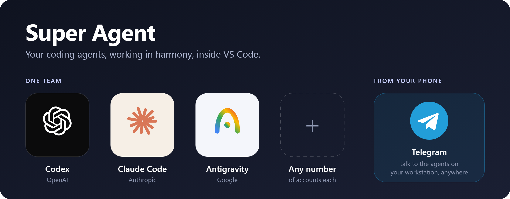
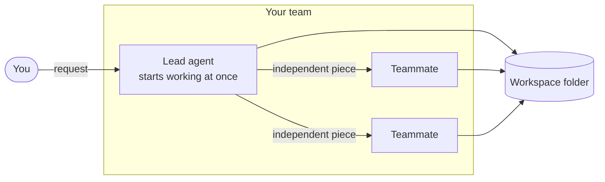
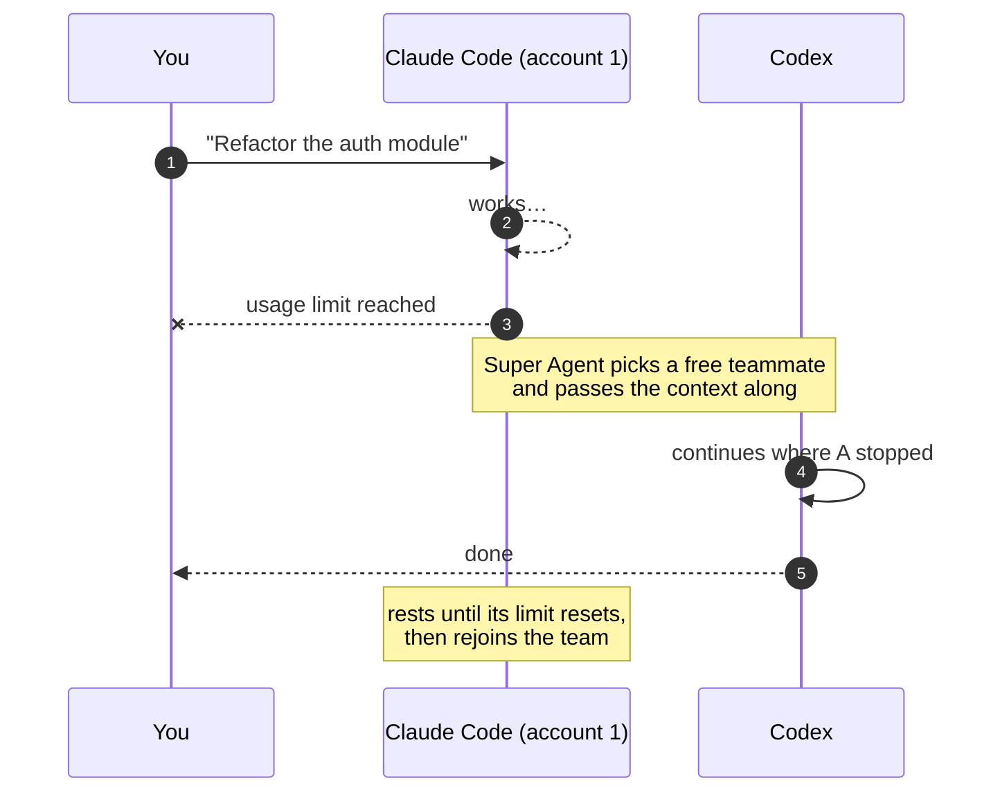
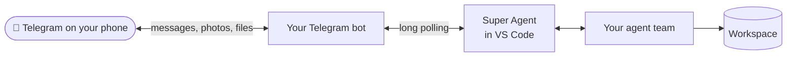

<p align="center">
  
</p>

<p align="center">
  <b>One agent leads, the team helps.</b><br>
  Super Agent turns every coding-agent login you have into a single team that works in your VS Code workspace,<br>
  and keeps working when one of them runs out of usage.
</p>

---

## Why Super Agent

Coding agents are great until you hit a usage limit in the middle of a task, or until you have three subscriptions and can only drive one at a time. Super Agent puts **Codex**, **Claude Code** and **Antigravity**, with as many accounts of each as you like, behind one panel, and lets them work together:

|   |   |
|---|---|
| 🤝 **Agents in harmony** | One agent leads a request and works on it right away. It hands independent pieces to free teammates, who work on them in parallel in the same folder. |
| 🔁 **Never stuck on a limit** | When the working agent runs out of usage, a free teammate picks up exactly where it stopped, with the full context. |
| 📱 **Your workstation, from your phone** | Pair a Telegram bot and talk to the team, browse your workspace and follow live progress from anywhere. |
| 📊 **Usage at a glance** | Usage left for every account, 5-hour and weekly, and when each limit resets. |

## Supported agents

| Agent | By | Accounts |
|---|---|---|
| **Codex** | OpenAI | as many as you like |
| **Claude Code** | Anthropic | as many as you like |
| **Antigravity** | Google | as many as you like |

Mix and match freely: two Claude Code accounts, a Codex account and an Antigravity account make a team of four. Each member shows its brand logo and the model it runs, and you can pick the model per agent.

## How the team works



- **No planning step.** The lead starts on the task immediately and keeps its own session from turn to turn.
- **Helping hands.** While it works, the lead can spin off independent pieces. Free teammates pick them up and work in parallel; their threads appear under the conversation.
- **Busy? Someone else takes it.** A message sent while the lead is busy goes to a free agent, which leads that request as its own thread.
- **Choose who leads.** Mark a preferred lead (♛), take members off the team, or pin a specific agent to a thread.

## Seamless hand-over when usage runs out



- **Same CLI** (for example, Claude Code account 1 to account 2): the new agent continues the **exact same session**.
- **Different CLI** (for example, Claude Code to Codex): the new agent receives a **full hand-over brief** with the conversation so far.
- An agent that ran out rests until its limit resets, using the reset time the provider reports, and then rejoins automatically.
- Free agents with the most usage left are chosen first.

## Telegram: the team in your pocket



- **Talk to the same team** the panel uses. Replies come back formatted, with code blocks intact.
- **Live progress.** One status message shows who is working, for how long and what they are doing right now, and turns into "Done in …" at the end.
- **Send photos and files**; they are attached to your request.
- **Browse the workspace** from the chat: tap through folders and files, see recently changed files and search by name.
- **Manage the team** from the chat: see who is on the team and who leads, and change it with a tap.
- **Threads:** start a new thread, switch between recent ones, or stop the current one.
- **Private by design.** Only the chat you pair (with a one-time code or a QR code) can talk to your agents. The extension polls Telegram itself, so nothing on your machine has to be reachable from the internet. The bot token is kept in VS Code's secret storage.

| Bot command | What it does |
|---|---|
| `/team` | who's on the team and who leads (tap to change) |
| `/files` | explore the workspace folder |
| `/recent` | recently changed files |
| `/find NAME` | search the workspace |
| `/new` | start a new thread |
| `/threads` | recent threads (switch with `/use N`) |
| `/stop` | stop the current thread |

## Usage, always visible

```
Claude Code · work        Codex · personal
5h   ████████░░  81% left  5h   ██████████  100% left
     resets in 1h 24m      week ███████░░░   70% left
                                resets in 2d
```

- Usage left for every account, for both the 5-hour and the weekly window.
- When each limit resets.
- The same numbers in the status bar tooltip.

## Built for VS Code

- **A panel in the Activity Bar** with the team as chips at the top, the conversation in the middle and a prompt box at the bottom.
- **Live agent output:** expand "is working" to see what the agent is doing, or open the full log.
- **Files changed by agents are marked in the Explorer** with the name of the agent that changed them.
- **Thread history** that survives restarts. A thread interrupted by closing VS Code picks up on your next message.
- **Attach images and files** to a request.
- **Browser tools:** agents can navigate, click, read pages and take screenshots (Playwright).
- **A chime** when work finishes, a different one when a helper finishes a piece or something fails.
- **Stop everything** with one command.
- Matches any VS Code theme.

## Project layout

```
src/
├── extension.ts        VS Code wiring: panel, commands, status bar, Explorer marks
├── engine/             the "lead works, helpers assist" engine and hand-over logic
├── core/               agent CLIs, accounts, usage tracking, settings
├── telegram*.ts        Telegram relay: pairing, progress, file browser, team panel
└── webview/            the Team panel UI (React)
tests/                  unit tests (Vitest)
```
